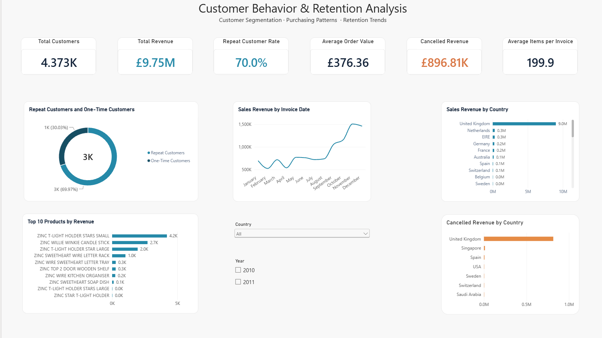

# Customer Behavior & Retention Analysis

## Overview
This project analyzes customer purchasing behavior, repeat purchasing patterns, revenue trends, product performance, and cancellations using SQL and Power BI. The goal is to identify insights into customer retention, purchasing activity, and sales performance.

## Dashboard Preview

## Key Metrics
- Total Customers
- Total Revenue
- Repeat Customer Rate
- Average Order Value
- Cancelled Revenue
- Average Items per Invoice

## Analysis
- Repeat customers vs. one-time customers
- Monthly sales revenue trends
- Sales revenue by country
- Top 10 products by revenue
- Cancelled revenue by country
- Customer purchasing behavior across selected years and countries

## Tools Used
- **SQL** — Data querying and analysis
- **Power BI** — Data visualization and dashboard development
- **Excel / CSV** — Data handling and preparation

## Key Objectives
- Understand repeat purchasing behavior
- Analyze customer retention patterns
- Identify revenue trends over time
- Determine top-performing products
- Compare revenue across countries
- Examine cancelled transactions and revenue

## Files
- `Dashboard/` — Power BI dashboard (.pbix)
- `Screenshots/` — Dashboard preview
- `SQL/` — SQL queries used for analysis

## Dataset
Online Retail transaction dataset containing invoice-level transaction information, including products, quantities, prices, customers, countries, and invoice dates.

## Author
Data analytics portfolio project focused on SQL analysis and Power BI visualization.
